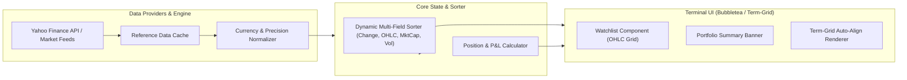

# Ticker 📈

> **Real-time terminal market surveillance, portfolio analytics, and multi-asset tracking with institutional-grade table views and dynamic cycle sorting.**

[](https://golang.org)
[](LICENSE)
[]()

---

## ⚡ Executive Summary

**Ticker** is a high-performance, keyboard-driven terminal market monitor built in Go with [Charmbracelet Bubbletea](https://github.com/charmbracelet/bubbletea). Designed for traders, portfolio managers, and command-line power users, Ticker delivers low-latency price discovery, complete OHLC (Open, High, Low, Close) execution data, pre/post-market tracking, and real-time portfolio valuation directly in your shell with zero bloat.

---

## ✨ Core Product Capabilities

### 1. 📊 Institutional-Grade OHLC & Market Matrix
Full tabular visibility across key price levels and liquidity metrics with automated terminal width adjustment and dynamic column alignment:
* **OHLC Metrics**: Instant visibility into Open, Day High, Day Low, and Close prices.
* **Liquidity & Valuation**: Real-time Trading Volume and Market Capitalization formatted in human-readable notation ($M, $B, $T).
* **Pre & Post-Market Intelligence**: Live quotes and delta percentages during extended trading hours with visual session state tags (`PRE`, `REG`, `POST`, `CLS`).

### 2. 🔄 Dynamic Multi-Criteria Cycle Sorting (`s`)
Effortlessly cycle through sorting dimensions in real time with visual ascending/descending header indicators:
$$\text{Change (\%)} \longrightarrow \text{Symbol} \longrightarrow \text{Close Price} \longrightarrow \text{Volume} \longrightarrow \text{Market Cap} \longrightarrow \text{High} \longrightarrow \text{Low} \longrightarrow \text{Open} \longrightarrow \text{Portfolio Weight}$$

### 3. 💼 Comprehensive Position & Portfolio Tracking
* Real-time Total Portfolio Value, Daily Unrealized P&L, and Net Cumulative Returns.
* Support for multiple cost basis lots, custom currency conversions, and variable-precision asset pricing (e.g. crypto vs equities).

### 4. ⚡ Ultra-Low Latency & High Resource Efficiency
* Compiled native Go binary with sub-millisecond rendering loops.
* Smart caching layer for reference metadata with resilient fallback handling during market volatility.

---

## 🚀 Quick Start

### 1. Build from Source (Go)
```bash
git clone https://github.com/visual-zimbabwe/ticker.git
cd ticker
go build -o ticker
sudo install -Dm755 ticker /usr/local/bin/ticker
```

### 2. Immediate Run
```bash
# Launch interactive watchlist
ticker --watchlist "AAPL,TSLA,NVDA,BTC-USD,ETH-USD,MSFT"

# Launch with full OHLC view enabled
ticker --watchlist "SPY,QQQ,AAPL,NVDA" --show-ohlc

# Launch with position tracking
ticker --show-positions
```

---

## ⌨️ Interactive Keyboard Controls

| Key | Action | Description |
| :---: | :--- | :--- |
| `s` | **Cycle Sort Mode** | Toggles sorting between Change, Symbol, Close, Volume, Market Cap, High, Low, Open, and User order. |
| `r` | **Refresh Quotes** | Manually forces an instant fetch of the latest market prices. |
| `h` / `?` | **Help Modal** | Displays active keybindings and shortcuts overlay. |
| `q` / `Ctrl+C` | **Quit** | Gracefully exits the application. |

---

## ⚙️ Configuration (`~/.ticker.yaml`)

Customize default watchlists, refresh cadences, and display preferences:

```yaml
# ~/.ticker.yaml
refresh_interval: 5
show_summary: true
show_ohlc: true
show_positions: true
show_fundamentals: true

watchlist:
  - AAPL
  - NVDA
  - TSLA
  - SPY
  - QQQ
  - BTC-USD
  - ETH-USD

lots:
  - symbol: AAPL
    quantity: 50
    unit_cost: 175.50
  - symbol: NVDA
    quantity: 100
    unit_cost: 110.25
```

---

## 🏗 System Architecture



---

## 📄 License
This project is open-source under the [GPL-3.0 License](LICENSE).
